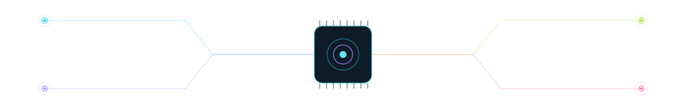
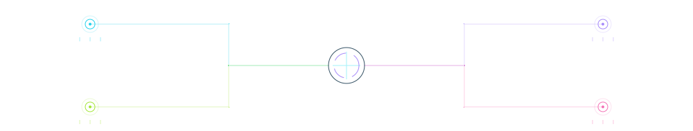

<!-- CONTENT GUIDE: Edit the text in this file to update your profile.
     SVG assets contain decorative shapes only. No image regeneration is needed.
     The analytics chart is refreshed automatically by the existing workflow. -->

<!-- Existing banner from your uploaded repository. -->

  

<!-- EDIT: your name, subtitle and introduction below. -->
# Ashu Newatia

### `FULL STACK` · `VOICE AI` · `IIT INDORE`

**Turning practical problems into useful software.**

I build campus tools, collaborative platforms, and conversational AI. 
Currently exploring voice interfaces, real-time systems, and quantum computing.

[Explore my repositories ↗](https://github.com/AshuNewatia?tab=repositories) · [Voice Assistant ↗](https://github.com/AshuNewatia/Live-Voice-Agent)

 

<!-- EDIT: interests and focus areas. All visible copy stays in this README. -->
### `01 / DEVELOPER SIGNAL`

> **Build with purpose.** Understand the problem. Build. Test. Iterate.
>
> **Explore with curiosity.** Voice AI, real-time collaboration, and quantum computing.
>
> **Strengthen the foundations.** Data structures, algorithms, and problem solving in C++.

 

### `02 / TECHNOLOGY STACK`

<!-- EDIT: lists below. Icons are decorative; update their URL too if you want
     the illustrated icon row to match a revised list. -->
**Languages** — C++, Python, JavaScript, TypeScript, HTML, CSS

**Frontend** — React, Next.js, Tailwind CSS, Three.js

**Backend & tools** — Node.js, Express, MongoDB, PostgreSQL, Git, GitHub, VS Code

 

### `03 / GITHUB TELEMETRY`

<!-- AUTOMATIC: edit the analytics script only to change chart styling or account.
     Values are fetched by the workflow; do not hand-edit the generated SVG. -->

Public GitHub data · Snapshot timestamp inside chart · Language shares count primary languages of owned non-fork public repositories.

 

### `04 / CONNECTED BUILDS`

**One connected set of ideas. Open a project node to explore.**

<!-- PROJECT NODE: copy one entire 
 block to add another project.
     The decorative network above is symbolic; it does not label or count projects. -->

<b>◉ CampusFlow</b> — team collaboration

### CampusFlow

Team collaboration meets developer workflow. A collaborative workspace connecting team tasks with GitHub activity.

**Technologies:** `React` · `Node.js` · `MongoDB` · `Socket.IO` · `GitHub integration`

<!-- Add the exact project repository or demo link here when ready. -->

<b>◉ Voice Assistant</b> — conversational AI

### Voice Assistant

Real-time conversations and spoken responses. Exploring how voice can make software more natural to use.

**Technologies:** `TypeScript` · `LiveKit` · `Speech AI`

[View repository ↗](https://github.com/AshuNewatia/Live-Voice-Agent)

<b>◉ Instibus</b> — campus mobility

### Instibus

Campus schedules, trip requests, and booking. Bringing everyday college transport into a single experience.

**Technologies:** `Next.js` · `PostgreSQL`

<!-- Add the exact project repository or demo link here when ready. -->

<b>◉ Campus Web</b> — creative interfaces

### Campus Web

Web experiences for TEDx, GDG, and the Science & Technology Council at IIT Indore.

**Technologies:** `React` · `Next.js` · `Three.js`

<!-- Add the exact project repository or demo links here when ready. -->

 

[Browse all repositories ↗](https://github.com/AshuNewatia?tab=repositories)

 

### `05 / THE NEXT ITERATION`

<!-- EDIT: update each directive without touching an image. -->
> **▸ BUILD**
>
> Useful campus products and interfaces people enjoy using.

> **▸ EXPLORE**
>
> Voice AI, real-time collaboration, and quantum computing.

> **▸ IMPROVE**
>
> Data structures, algorithms, and problem solving in C++.

 

<b><code>OPEN / PERSONAL.LOG</code></b>

Away from the editor: anime, chess puzzles, quizzes, and physics or mathematics rabbit holes.

 

### Good ideas deserve to be built.

**Let's make the next one useful.**

[GitHub ↗](https://github.com/AshuNewatia)

<!-- EDIT: add verified LinkedIn, portfolio or public email links here. -->

