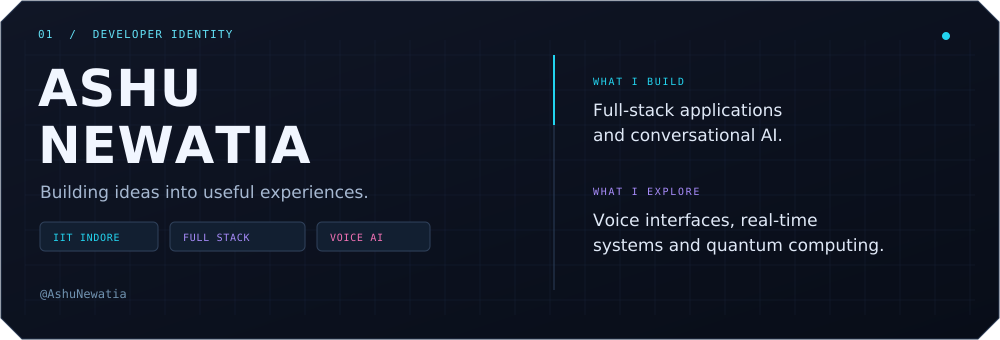
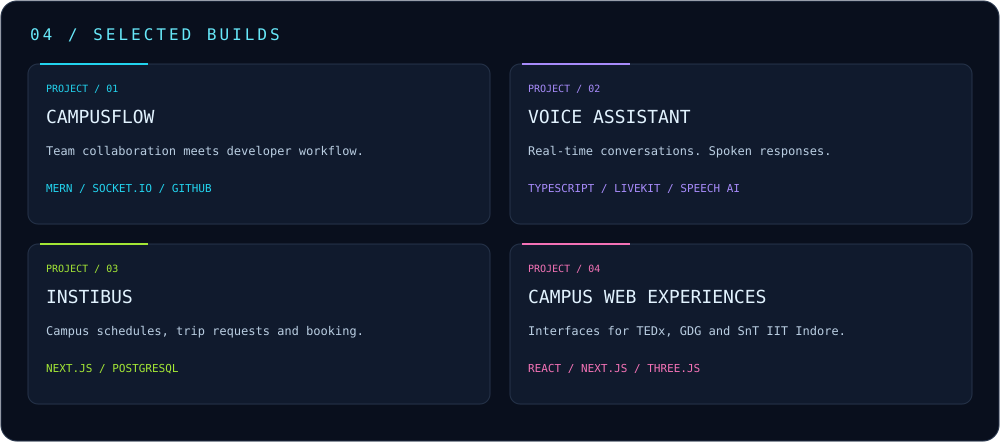
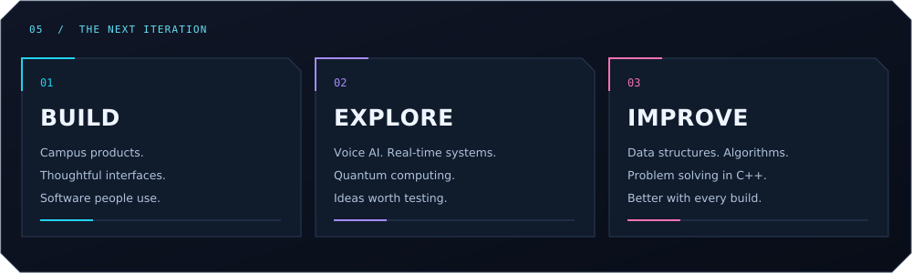

<!-- All custom art is included in assets/. Upload that folder with this README. -->

GIF: <a href="https://giphy.com/gifs/cyberpunkgame-cyberpunk-cp-cyberpunk2077-SUcnmocyRKkfSil9xd">Cyberpunk 2077 / CD PROJEKT RED · GIPHY</a>

 

  

  

 

### `02 / TECHNOLOGY STACK`

**LANGUAGES & INTERFACES**

  

**FRONTEND SYSTEMS**

  

**BACKEND & DEVELOPER TOOLS**

  

  

Public GitHub data · Daily snapshots · Language shares count primary languages of owned non-fork public repositories.

   

 

**[EXPLORE VOICE ASSISTANT ↗](https://github.com/AshuNewatia/Live-Voice-Agent)** &nbsp; · &nbsp; **[ALL REPOSITORIES ↗](https://github.com/AshuNewatia?tab=repositories)**

 

<b><code>OPEN / PERSONAL.LOG</code></b>

 

Away from the editor: anime, chess puzzles, quizzes, and physics or mathematics rabbit holes.

 

### `GOOD IDEAS DESERVE TO BE BUILT.`

**Let's make the next one useful.**

<!-- Add your verified LinkedIn, portfolio, or public email links here. -->

