<!-- CONTENT GUIDE: Edit the text in this file to update your profile.
     The animated header (assets/hero.svg) is generated by scripts/generate_art.py.
     The telemetry block between the START/END markers is rewritten hourly from live GitHub data; do not edit inside it. -->

<!-- Avatar and animated header side by side. Edit header text in scripts/generate_art.py. -->
<table>
<tr>
<td width="170" align="center" valign="middle">

</td>
<td valign="middle">

</td>
</tr>
</table>

<!-- EDIT: subtitle and introduction below. -->
### `FULL STACK` · `VOICE AI` · `IIT INDORE`

**Turning practical problems into useful software.**

I build campus tools, collaborative platforms, and conversational AI. 
Currently exploring voice interfaces, real-time systems, and quantum computing.

[Repositories ↗](https://github.com/AshuNewatia?tab=repositories) &nbsp;·&nbsp; [LinkedIn ↗](https://www.linkedin.com/in/ashunewatia23/)

<!-- EDIT: interests and focus areas. -->
### `01 / DEVELOPER SIGNAL`

> **Build with purpose.** Understand the problem. Build. Test. Iterate.
>
> **Explore with curiosity.** Voice AI, real-time collaboration, and quantum computing.
>
> **Strengthen the foundations.** Data structures, algorithms, and problem solving in C++.

### `02 / TECHNOLOGY STACK`

<!-- EDIT: lists below. Update the icon URL too if you change a list. -->
**Languages** — C++, Python, JavaScript, TypeScript, HTML, CSS

**Frontend** — React, Next.js, Tailwind CSS, Three.js

**Backend & tools** — Node.js, Express, MongoDB, PostgreSQL, Git, GitHub, VS Code

### `03 / GITHUB TELEMETRY`

<!-- GITHUB-TELEMETRY:START -->

### ⚡ 435 contributions &nbsp; · &nbsp; 1-day streak &nbsp; · &nbsp; 5-day best

**10 repositories** &nbsp; / &nbsp; **0 stars** &nbsp; / &nbsp; **3 followers**

 

**CONTRIBUTION SIGNAL**

2025-11-08 → 2026-11-07 · 68 active days · 5 original repos · 5 forks

Sources: GitHub REST API + GitHub GraphQL API. Refreshes hourly via GitHub Actions; this is a timestamped snapshot, not a request on every profile visit.

**LANGUAGE FREQUENCIES**

🔵 **JavaScript 50%** · 2 repos &nbsp; / &nbsp; 🟣 **Python 25%** · 1 repo &nbsp; / &nbsp; 🟢 **TypeScript 25%** · 1 repo

  

Fetched from GitHub · 2026-11-07 09:42 UTC · Hourly refresh

Signal definitions, sources & refresh

The upper signal plots actual weekly contribution totals; the matrix below shows daily contributions. Moving scanners, orbiting particles and glowing traces are decoration, not additional measurements.

Contributions and best streak cover the last 365 UTC dates. An unfinished day with no contributions does not break yesterday’s streak. GitHub may include anonymized private activity if enabled on your profile.

Stars are received stars on owned non-fork public repositories. Language widths count primary languages of owned non-fork public repositories, not time spent or code bytes. Legend order matches segments from left to right.

Sources: GitHub REST API + GitHub public contribution calendar. Timestamped hourly snapshots; no fetch runs on profile visits.

[Inspect fetched data](./assets/telemetry.json) · [Run refresh](https://github.com/AshuNewatia/AshuNewatia/actions/workflows/profile-analytics.yml)

<!-- GITHUB-TELEMETRY:END -->

### `04 / CONNECTED BUILDS`

**One connected set of ideas. Open a project to explore.**

<!-- PROJECT NODE: copy one entire 
 block to add another project. -->

<b>◉ CampusFlow</b> — team collaboration

### CampusFlow

Team collaboration meets developer workflow. A collaborative workspace connecting team tasks with GitHub activity.

**Technologies:** `React` · `Node.js` · `MongoDB` · `Socket.IO` · `GitHub integration`

[View repository ↗](https://github.com/AshuNewatia/SoC)

<!-- Add the exact project repository or demo link here when ready. -->

<b>◉ Voice Assistant</b> — conversational AI

### Voice Assistant

Real-time conversations and spoken responses. Exploring how voice can make software more natural to use.

**Technologies:** `TypeScript` · `LiveKit` · `Speech AI`

[View repository ↗](https://github.com/AshuNewatia/Live-Voice-Agent)

<b>◉ Instibus</b> — campus mobility

### Instibus

Campus schedules, trip requests, and booking. Bringing everyday college transport into a single experience.

**Technologies:** `Next.js` · `PostgreSQL`

[View repository ↗](https://github.com/AshuNewatia/Instibus)

<!-- Add the exact project repository or demo link here when ready. -->

<b>◉ Campus Web</b> — creative interfaces

### Campus Web

Web experiences for TEDx, GDG, and the Science & Technology Council at IIT Indore.

**Technologies:** `React` · `Next.js` · `Three.js`

<!-- Add the exact project repository or demo links here when ready. -->

 

[Browse all repositories ↗](https://github.com/AshuNewatia?tab=repositories)

### Good ideas deserve to be built.

**Let's make the next one useful.**

[GitHub ↗](https://github.com/AshuNewatia) &nbsp;·&nbsp; [LinkedIn ↗](https://www.linkedin.com/in/ashunewatia23/)

