  

  <strong>
    BUILD SYSTEMS &nbsp; / &nbsp;
    SOLVE PROBLEMS &nbsp; / &nbsp;
    KEEP EXPLORING
  </strong>

  <a href="https://github.com/AshuNewatia?tab=repositories">[ REPOSITORIES ↗ ]</a>
  &nbsp; ✦ &nbsp;
  <a href="https://www.linkedin.com/in/ashunewatia23/">[ LINKEDIN ↗ ]</a>

<h2 align="center">
  
</h2>

<table width="100%">
<tr>
  <td width="62%" valign="middle">
    
  </td>
  <td width="38%" align="center" valign="middle">
    
     
    
  </td>
</tr>
</table>

  
  

 

<h2 align="center">
  
</h2>

  

  

  

  <a href="https://github.com/AshuNewatia?tab=repositories">
    <strong>[ VIEW ALL REPOSITORIES ↗ ]</strong>
  </a>

 

<h2 align="center">
  
</h2>

  

<strong>◈ &nbsp; EXPAND / DEVELOPMENT DIRECTIVES</strong>

 

- **Build:** Create interfaces and systems around real problems.
- **Explore:** Experiment with real-time applications and intelligent tools.
- **Improve:** Learn through shipping, feedback, and iteration.

 

<h2 align="center">
  
</h2>

<!-- GITHUB-TELEMETRY:START -->

### ⚡ 487 contributions in the last year &nbsp; · &nbsp; 74 active days

**5** original public repositories &nbsp; / &nbsp; **4** followers

Last 365 UTC dates · updated 19 Nov 2026 · 04:14 UTC · GitHub GraphQL API

[View GitHub’s contribution calendar ↗](https://github.com/AshuNewatia#overview)

<!-- GITHUB-TELEMETRY:END -->

  
  
  

 

---

  <strong>◈ &nbsp; HAVE AN IDEA? LET’S BUILD IT. &nbsp; ◈</strong>

  <a href="https://www.linkedin.com/in/ashunewatia23/">[ INITIATE CONTACT ↗ ]</a>
  &nbsp; / &nbsp;
  <a href="https://github.com/AshuNewatia?tab=repositories">[ EXPLORE PROJECTS ↗ ]</a>

  END OF TRANSMISSION // ASHU NEWATIA

