  

  <strong>
    BUILD SYSTEMS &nbsp; / &nbsp;
    SOLVE PROBLEMS &nbsp; / &nbsp;
    KEEP EXPLORING
  </strong>

  <a href="https://github.com/AshuNewatia?tab=repositories">[ REPOSITORIES ↗ ]</a>
  &nbsp; ✦ &nbsp;
  <a href="https://www.linkedin.com/in/ashunewatia23/">[ LINKEDIN ↗ ]</a>

---

## ◈ 01 / SYSTEM PROFILE

Building real-time products and intelligent interfaces. I enjoy connecting collaborative software, campus tools and voice AI with practical problems.

  

## ◈ 02 / FEATURED MISSIONS

<table width="100%">
<tr>
  <td>
    <strong>01 / CAMPUSFLOW</strong> 
    IITISoC &#x27;26 · 3rd place  
    Real-time collaboration with two-way GitHub issue sync.  
    <code>MERN / Socket.IO / Octokit</code>  
    <a href="https://github.com/AshuNewatia/SoC">OPEN REPOSITORY ↗</a>
  </td>
</tr>
<tr>
  <td>
    <strong>02 / VOICE AGENT</strong> 
    VOICE AI  
    A real-time AI voice terminal for natural conversations.  
    <code>LiveKit / Deepgram / Gemma-4 / Cartesia</code>  
    <a href="https://github.com/AshuNewatia/Live-Voice-Agent">OPEN REPOSITORY ↗</a>
  </td>
</tr>
<tr>
  <td>
    <strong>03 / INSTIBUS</strong> 
    CAMPUS TRANSPORT  
    Campus transit, trip bookings and seat availability.  
    <code>Next.js / PostgreSQL</code>  
    <a href="https://github.com/AshuNewatia/Instibus">OPEN REPOSITORY ↗</a>
  </td>
</tr>
</table>

## ◈ 03 / THE TOOLKIT

| MODULE | INSTALLED |
| :--- | :--- |
| **LANGUAGES** | `C++` · `TypeScript` · `Python` · `JavaScript` |
| **WEB** | `React` · `Next.js` · `Node.js` · `MongoDB` · `PostgreSQL` |
| **REAL-TIME** | `LiveKit` · `WebRTC` · `Socket.IO` · `Deepgram` · `Cartesia` |

## ◈ 04 / GITHUB SIGNAL

<!-- GITHUB-TELEMETRY:START -->

### ⚡ 480 contributions in the last year &nbsp; · &nbsp; 74 active days

**5** original public repositories &nbsp; / &nbsp; **4** followers

Last 365 UTC dates · updated 18 Nov 2026 · 16:07 UTC · GitHub GraphQL API

[View GitHub’s contribution calendar ↗](https://github.com/AshuNewatia#overview)

<!-- GITHUB-TELEMETRY:END -->

  
    Contribution calendar and complete history →
    <a href="https://github.com/AshuNewatia#overview">OPEN GITHUB ↗</a>
  

---

  <strong>HAVE AN IDEA? LET’S BUILD IT.</strong>
    
  <a href="https://www.linkedin.com/in/ashunewatia23/">CONNECT ON LINKEDIN ↗</a>
  &nbsp; / &nbsp;
  <a href="https://github.com/AshuNewatia?tab=repositories">EXPLORE REPOSITORIES ↗</a>
    
  END OF TRANSMISSION // ASHU NEWATIA

