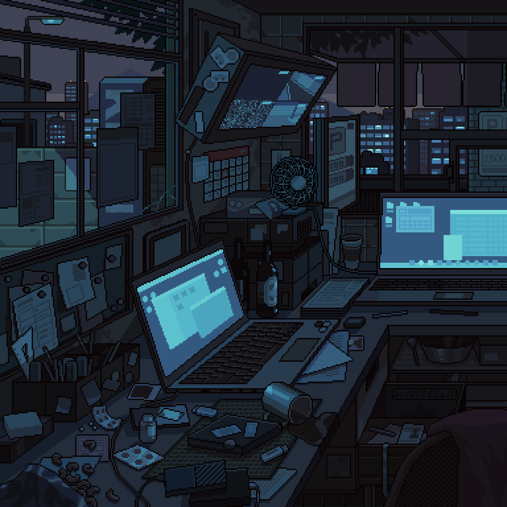

<div align="center">

<table>
  <tr>
    <td width="72%">
      
    </td>
    <td width="28%">
      
    </td>
  </tr>
</table>

<br />

**`[ BUILD SYSTEMS. SOLVE PROBLEMS. KEEP EXPLORING. ]`**

[](https://github.com/AshuNewatia)
[](https://www.linkedin.com/in/ashunewatia23/)

</div>

---

## `> ACCESSING SYSTEM PROFILE...`

```text
USER        : Ashu Newatia
INSTITUTE   : IIT Indore
DOMAIN      : Full-stack development / Voice AI / Problem solving
STATUS      : Building, learning and shipping